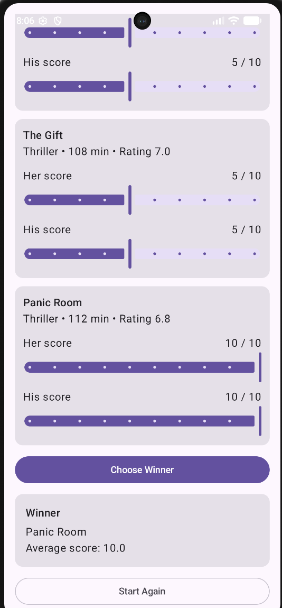

# Movie Match

Movie Match is a simple Android application developed using Kotlin and Jetpack Compose.

The application helps two people choose a movie to watch together. Users select a maximum movie duration and a preferred genre for each person. The application then displays suitable movies, allows both users to rate each movie from 1 to 10, and selects the movie with the highest average score.

## Features

- Filter movies by maximum duration
- Select a separate genre for each user
- Display suitable movies in a scrollable list
- Rate movies from 1 to 10 using sliders
- Calculate the average user score
- Select the movie with the highest average score
- Application state is managed using ViewModel
- State is preserved during device rotation

## Technologies

- Kotlin
- Android Studio
- Jetpack Compose
- Material 3
- ViewModel

## State Management

The application demonstrates different Compose state management approaches:

- `remember` is used for temporary UI state such as whether a genre dropdown menu is open.
- `rememberSaveable` is used for the maximum duration input so that it survives Activity recreation.
- `ViewModel` stores application logic and screen state including genres, movie recommendations, ratings, and the selected winner.

## How to Run

1. Clone or download this repository.
2. Open the project in Android Studio.
3. Wait for Gradle synchronization to finish.
4. Start an Android emulator or connect an Android device.
5. Run the `app` configuration.

## Screenshots

### Movie Selection and Rating

### Winner

